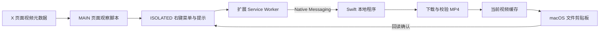

# 架构与数据流

XVC 包含 Manifest V3 浏览器扩展和一个 Swift Native Messaging 程序。正式运行无需开发服务器、Node.js 或 Python。

## 浏览器侧

- `media-core.js` 提取媒体信息、验证允许的视频地址，并根据海报或媒体 ID 关联鼠标所指的视频。不能确认对应关系时拒绝复制。
- `page-observer.js` 在 MAIN 环境观察 X 已收到的 GraphQL 响应，向隔离环境传递精简媒体元数据。
- `content.js` 在 ISOLATED 环境提供右键菜单和顶部提示。下载入口需要真实用户事件，提示不会锁定页面焦点。
- `service-worker.js` 验证页面来源、顶层框架、任务 ID 和视频地址，再连接固定的本地宿主 `com.xvc.native`。

构建时将媒体模块分别和两个入口合成 `page-main.js`、`content-bundle.js`，保证两个 Chrome 执行环境各自独立初始化。

## 本地程序

浏览器按任务启动 `xvc-host`，通过标准输入输出交换 4 字节小端长度头与 JSON 消息。宿主检查调用方扩展来源，再处理任务。

1. 获取跨浏览器共享的文件锁，拒绝并行下载。
2. 读取当前设置快照；按保留策略清理 XVC 历史视频、状态记录和残留半成品。
3. 从允许的 CDN 流式下载完整 MP4。有限制时，响应长度和累计实际字节均受本次任务上限约束；默认 25,000,000 字节，可配置 1–500 MB，或设为无限制。
4. 校验 MP4 box、视频轨道和时长，计算 SHA-256，再以 `xvc-yyyy-mm-dd-12hex.mp4` 命名最终文件。移动不覆盖现有文件，重名时重试。
5. 写入 `public.file-url`，回读并确认是同一文件后发送成功事件。
6. 退出进程，由操作系统释放文件锁。

重定向仍须满足来源限制。取消、断开连接或下载失败时删除半成品；已可能被剪贴板引用的最终文件在不确定的写入失败时保留。

## 成功判定

下载、内容校验、剪贴板写入是独立阶段。Service Worker 只接受同时携带 `clipboardType: "public.file-url"` 和 `verified: true` 的成功消息。

网页链接、浏览器自定义剪贴板数据或仅完成下载，都不构成复制成功。公开仓库中的 `experiments/` 保留了早期对照实验，用于解释这些表示的差异。

## 缓存与状态

默认目录为 `~/Library/Caches/XVC/videos/`，自定义目录固定使用所选父目录下的 `XVC-videos`。默认只保留当前 MP4 和 `current.json`；开启保留后，完整视频不清理，残留半成品仍清理。系统剪贴板引用旧文件时，删除缓存会使旧引用无法继续粘贴。

本地程序在 `~/Library/Application Support/XVC/xvc-host`。Chrome / Edge 的用户级 Native Messaging 配置只允许固定 XVC 扩展 ID 调用。

## 设置与兼容握手

`popup.html` 同时注册为工具栏弹窗和标准 `options_ui` 页面。仅该扩展页面可发起设置 RPC；X 页面只能启动/取消当前视频任务及打开设置页。设置不通过网页传入下载任务，而由宿主在持锁后读取，以免页面覆盖下载上限。

宿主将 `maxMB`、`unlimited`、`keepCache` 和可选缓存路径原子保存到 `~/Library/Application Support/XVC/settings.json`（0600），两种浏览器共用。大小需为 1–500 的整数，开关严格验证为布尔值。目录仅能通过明确的 `setDirectory` 操作更新，要求绝对路径或展开后的 `~/` 路径、现有可写父目录及专用子目录。切换与恢复默认不会搬移或删除旧文件。

锁位于 Application Support/XVC，与缓存位置无关，下载、修改设置、切换目录、恢复默认共用同一把锁。默认恢复整个设置对象，不仅是大小上限。

`ping` 返回协议版本 2、宿主版本、设置和缓存位置；`keepAlive` 握手后才能开始复制。扩展发现旧宿主缺少设置能力时要求升级，不会静默按旧 25 MB 限制下载。设置命令为 `updateSettings`、`setDirectory`、`openCache`、`resetSettings`，均为按需启动的本地调用，无监听端口。
