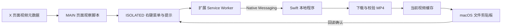

# 架构与数据流

XVC 包含 Manifest V3 浏览器扩展和一个 Swift Native Messaging 程序。正式运行无需开发服务器、Node.js 或 Python。

## 浏览器侧

- `media-core.js` 提取媒体信息、验证允许的视频地址，并根据海报或媒体 ID 关联鼠标所指的视频。不能确认对应关系时拒绝复制。
- `page-observer.js` 在 MAIN 环境观察 X 已收到的 GraphQL 响应，向隔离环境传递精简媒体元数据。
- `content.js` 在 ISOLATED 环境提供右键菜单和顶部提示。下载入口需要真实用户事件，提示不会锁定页面焦点。
- `service-worker.js` 验证页面来源、顶层框架、任务 ID 和视频地址，再连接固定的本地宿主 `com.xvc.native`。

构建时将媒体模块分别和两个入口合成 `page-main.js`、`content-bundle.js`，保证两个 Chrome 执行环境各自独立初始化。

## 本地程序

浏览器按任务启动 `xvc-host`，通过标准输入输出交换 4 字节小端长度头与 JSON 消息。宿主检查调用方扩展来源，再处理任务。

1. 获取跨浏览器共享的文件锁，拒绝并行下载。
2. 清理 XVC 历史视频、状态记录和残留半成品。
3. 从允许的 CDN 流式下载完整 MP4。响应长度和累计实际字节均受 25,000,000 字节上限约束。
4. 校验 MP4 box、视频轨道和时长，计算 SHA-256，再将半成品改名为最终文件。
5. 写入 `public.file-url`，回读并确认是同一文件后发送成功事件。
6. 退出进程，由操作系统释放文件锁。

重定向仍须满足来源限制。取消、断开连接或下载失败时删除半成品；已可能被剪贴板引用的最终文件在不确定的写入失败时保留。

## 成功判定

下载、内容校验、剪贴板写入是独立阶段。Service Worker 只接受同时携带 `clipboardType: "public.file-url"` 和 `verified: true` 的成功消息。

网页链接、浏览器自定义剪贴板数据或仅完成下载，都不构成复制成功。公开仓库中的 `experiments/` 保留了早期对照实验，用于解释这些表示的差异。

## 缓存与状态

缓存目录为 `~/Library/Caches/XVC/videos/`。正常完成后保留当前一个 MP4 和 `current.json`，下次任务开始时删除旧内容。系统剪贴板引用旧文件时，删除缓存会使旧引用无法继续粘贴。

本地程序在 `~/Library/Application Support/XVC/xvc-host`。Chrome / Edge 的用户级 Native Messaging 配置只允许固定 XVC 扩展 ID 调用。
